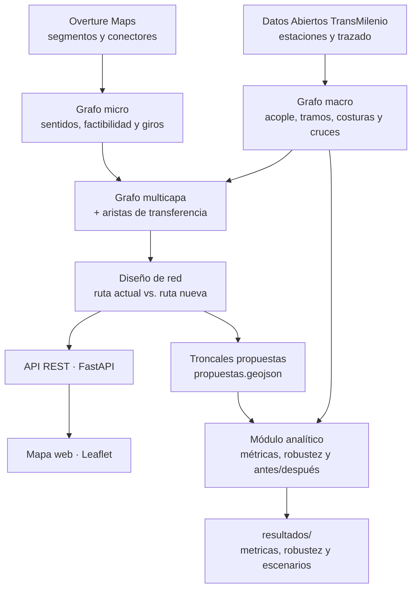

# IntegraBog

IntegraBog es un modelo de grafos de la red troncal de TransMilenio construido sobre la malla vial real de Bogotá y Soacha. Permite diagnosticar la conectividad de la red existente, medir su estructura con herramientas de matemáticas discretas y proponer corredores troncales nuevos que sean físicamente viables para un bus biarticulado: que respeten el sentido de cada vía, los giros prohibidos y las restricciones de la infraestructura.

El proyecto combina los datos abiertos de TransMilenio con la red de calles de Overture Maps y expone sus resultados a través de una API REST y un mapa web interactivo.

Proyecto final del curso Matemáticas Discretas, Universidad Nacional de Colombia, 2026.

## Contenido

- [Características principales](#características-principales)
- [Arquitectura del modelo](#arquitectura-del-modelo)
- [Requisitos](#requisitos)
- [Instalación](#instalación)
- [Estructura del proyecto](#estructura-del-proyecto)
- [Uso](#uso)
- [Módulo analítico: matemáticas discretas](#módulo-analítico-matemáticas-discretas)
- [Parámetros del modelo](#parámetros-del-modelo)
- [Pruebas](#pruebas)
- [Desarrollo e integración continua](#desarrollo-e-integración-continua)
- [Fuentes de datos y atribución](#fuentes-de-datos-y-atribución)
- [Alcance y limitaciones](#alcance-y-limitaciones)
- [Licencia](#licencia)

## Características principales

- **Malla vial de Overture Maps.** La red de calles proviene del tema *transportation* de Overture Maps y se descarga y particiona con City2Graph. La topología se construye a partir de los identificadores GERS de los conectores y no por coincidencia de coordenadas, como establece la especificación de Overture: dos vías que se cruzan sin compartir un conector, como un puente sobre una avenida, no quedan conectadas en el grafo.

- **Dígrafo estricto de circulación.** Cada pieza de vía solo puede recorrerse en los sentidos que permiten las reglas de acceso de Overture. Los sentidos que faltan en los datos se completan con reglas geométricas verificables:
    - una calzada separada sin regla toma el sentido opuesto al de su calzada paralela, con tránsito por la derecha;
    - en seis avenidas con separador central confirmado (Av. Carrera 72, Av. Calle 116, Av. Calle 72, Av. Carrera 7, Av. Carrera 60 y Av. Calle 59 Sur), la regla se aplica aunque ninguna de las dos calzadas traiga sentido;
    - las piezas cortas de una calzada heredan el sentido de su segmento;
    - las rotondas incompletas se cierran en sentido antihorario, y los casos restantes se corrigen a mano.

- **Giros prohibidos y giros en U.** Las restricciones de giro de Overture (`prohibited_transitions`), incluidas las que encadenan varios tramos, se traducen a la malla: en el área de estudio hay 2.336 reglas, de las cuales 2.209 aplican al bus de referencia. La ruta de una troncal nueva se calcula con un algoritmo de Dijkstra sobre un espacio de estados (nodo, rumbo de llegada y prohibiciones en curso) que respeta esas reglas y descarta todo giro de más de 150°, una maniobra que un biarticulado no puede hacer en un cruce.

- **Factibilidad física.** Una troncal nueva solo puede ir por vías arteriales (`motorway`, `trunk` o `primary`), pavimentadas y sin restricciones que excluyan al vehículo de referencia: un bus biarticulado de 28 m de largo, 2,60 m de ancho, 3,40 m de alto y 42 t. Se añaden descartes por conocimiento local, como la Av. Calle 153, y una excepción de acceso: a menos de 300 m de las estaciones de origen y destino se admiten vías menores, para que la ruta pueda llegar desde la estación hasta el corredor.

- **Tiempos de viaje con penalidad por transbordo.** La red actual se recorre a 25,2 km/h por el trazado oficial, y cada cambio de troncal cuesta 5 minutos, que representan la caminata entre vagones y la espera de la siguiente ruta. La ruta nueva usa la misma velocidad, ajustada por la jerarquía de cada vía, y el tramo a pie entre la estación y la calle se recorre a 4,5 km/h. La aplicación y el módulo analítico comparten la misma función de costo, de modo que sus tiempos son directamente comparables.

- **Red troncal conexa y auditable.** Las estaciones se acoplan al trazado oficial por proyección ortogonal; las piezas del trazado separadas por brechas de hasta 50 m se cosen, y las troncales que se cruzan o se encuentran se unen con aristas de cruce, que modelan los transbordos. Cada conexión inferida puede revisarse con `diagnostico_costura`, y las correcciones manuales quedan documentadas en `config.py` con su motivo. Por ejemplo, la conexión Virrey ↔ La Castellana está bloqueada porque en el puente de la Calle 92 los buses solo pasan de la NQS a la Autopista Norte hacia el norte.

- **Pares críticos.** El modelo identifica pares de estaciones a menos de 1 km en línea recta con el mayor factor de rodeo por la red troncal (distancia por la red dividida por la distancia en línea recta) y, para cada uno, compara la ruta actual con una troncal nueva por la malla vial: tiempo, transbordos y ahorro estimado.

- **Módulo analítico.** Tres análisis sobre el grafo de la red troncal ([detalles](#módulo-analítico-matemáticas-discretas)), con salidas en GeoJSON, CSV y Markdown listas para el informe:
    - métricas de distancia: excentricidad de cada estación, diámetro, radio, centro, periferia y distancia media, por tiempo de viaje, distancia y número de tramos;
    - robustez: puntos de corte, puentes, número ciclomático, conectividad, intermediación, eficiencia global y efecto de cerrar cada estación y cada enlace;
    - comparación antes/después: las mismas métricas sobre la red con las troncales propuestas, con las mismas estaciones, y el aporte de cada propuesta por separado.

- **Interfaz web.** Un mapa Leaflet servido por la misma API (FastAPI). Las troncales se dibujan con la geometría curva real del trazado oficial y las rutas propuestas con la forma de cada calle, no con segmentos rectos entre nodos. Un interruptor de capas muestra u oculta las conexiones lógicas que infiere el modelo (costuras y cruces), que se dibujan punteadas y en otro color para no confundirlas con troncales.

- **Reproducibilidad.** La malla procesada se guarda en GeoParquet con una versión del proceso y se regenera sola cuando cambia un parámetro que la afecta; el release de Overture utilizado queda registrado en los metadatos de la caché. El proyecto cuenta con más de 200 pruebas automatizadas e integración continua con Ruff, mypy y pytest.

## Arquitectura del modelo

El modelo es un grafo multicapa. La red troncal y la malla vial se construyen por separado, cada una a partir de su fuente de datos, y se unen mediante aristas de transferencia peatonal entre cada estación y las intersecciones que le dan acceso.



| Capa | Nodos | Aristas | Módulos |
|---|---|---|---|
| Macro (red troncal) | 153 estaciones | 368 dirigidas: 260 de tramo, 40 de costura y 68 de cruce | `graph/macro.py`, `snapping.py`, `builder.py`, `costura.py`, `cruces.py`, `geometria_troncal.py` |
| Micro (malla vial) | 113.552 conectores de Overture | 243.510 piezas de vía dirigidas | `graph/micro.py`, `sentido.py`, `giros.py` |
| Transferencia | — | Estación ↔ conectores de sus calzadas de acceso, a pie | `graph/multilayer.py` |

Cifras de la corrida de referencia de noviembre de 2026, con el release `2026-09-23.1` de Overture.

## Requisitos

- Python 3.13 o superior. La integración continua usa 3.13; el desarrollo se hace también con 3.14.
- [uv](https://docs.astral.sh/uv/), el gestor de paquetes recomendado. También funciona con pip.
- Conexión a internet la primera vez, para descargar la malla vial de Overture Maps. Las ejecuciones siguientes usan la caché local.

## Instalación

Desde la raíz del repositorio:

```bash
uv sync
```

O con pip, en modo editable:

```bash
pip install -e .
```

El modo editable es necesario porque las rutas a `data/` y `resultados/` se calculan desde la ubicación del paquete dentro del repositorio; una instalación como copia (`pip install .`) no las encuentra.

### Datos de entrada

| Ruta | Contenido | En git |
|---|---|---|
| `data/raw/Estaciones_Troncales_de_TRANSMILENIO.geojson` | Estaciones troncales (Datos Abiertos de TransMilenio) | Sí |
| `data/raw/Trazados_Troncales_de_TRANSMILENIO.geojson` | Trazado oficial de las troncales | Sí |
| `data/raw/overture/` | Segmentos y conectores crudos de Overture, con el release usado en `bogota_metadatos.json` | No (caché) |
| `data/processed/` | Malla vial procesada (`malla_vial_overture_*.parquet`) | No (caché) |

La primera construcción descarga la malla con City2Graph, que necesita acceso a `stac.overturemaps.org` y al bucket público de S3 de Overture. Si el equipo no tiene ese acceso, los dos archivos se pueden descargar desde otro equipo con el CLI oficial de Overture, incluido en las dependencias, y copiar en `data/raw/overture/`:

```bash
uv run overturemaps download --bbox="-74.25,4.46,-73.99,4.84" -f geoparquet --type=segment -o data/raw/overture/bogota_segment.parquet
uv run overturemaps download --bbox="-74.25,4.46,-73.99,4.84" -f geoparquet --type=connector -o data/raw/overture/bogota_connector.parquet
```

## Estructura del proyecto

```
IntegraBog/
├── .github/workflows/ci.yml           # Integración continua: Ruff, mypy y pytest
├── data/
│   ├── raw/                           # Datos de entrada
│   │   ├── Estaciones_Troncales_de_TRANSMILENIO.geojson
│   │   ├── Trazados_Troncales_de_TRANSMILENIO.geojson
│   │   └── overture/                  # Descarga cruda de Overture (caché, fuera de git)
│   └── processed/                     # Malla vial procesada en GeoParquet (caché, fuera de git)
├── frontend/                          # Mapa web, servido por la API en "/"
│   ├── index.html
│   ├── app.js                         # Leaflet: trazado, estaciones, rutas y capas lógicas
│   └── style.css
├── resultados/
│   ├── metricas/                      # Salidas de metricas_red
│   │   ├── metricas_red.geojson       # Caminos del diámetro y excentricidad por estación
│   │   ├── excentricidades.csv        # Una fila por estación, en los tres criterios
│   │   └── metricas_red.md            # Tablas listas para el informe
│   ├── robustez/                      # Salidas de robustez_red
│   │   ├── robustez_red.md            # Estructura, intermediación y cierres
│   │   ├── estaciones.csv             # Grado, punto de corte, intermediación y cierre
│   │   ├── enlaces.csv                # Puente y efecto del cierre de cada enlace
│   │   └── robustez_red.geojson       # Puentes, puntos de corte y estaciones más usadas
│   └── escenarios/                    # Antes y después con las troncales propuestas
│       ├── propuestas.geojson         # Salida de proponer_troncales
│       ├── antes_despues.md           # Tabla antes/después y aporte de cada propuesta
│       ├── antes_despues.csv          # Cambios por estación
│       ├── antes_despues.geojson      # Propuestas, puentes que desaparecen y mejoras
│       └── final/                     # Escenario final: conexión física y ruta continua
│           ├── propuestas.geojson     # Las propuestas elegidas
│           ├── comparacion_transbordo.md   # Las dos variantes lado a lado
│           ├── comparacion_transbordo.csv  # Tiempo medio e intermediación por estación
│           ├── conexion_fisica/       # Informe completo, con 5 min de transbordo
│           └── ruta_continua/         # Informe completo, sin transbordo
├── src/integrabog/
│   ├── config.py                      # Rutas y parámetros del modelo, en un solo lugar
│   ├── data/
│   │   └── loader.py                  # Carga de estaciones y trazado en EPSG:3116
│   ├── graph/
│   │   ├── snapping.py                # Acople de cada estación a su tramo del trazado
│   │   ├── builder.py                 # Aristas de tramo entre estaciones consecutivas
│   │   ├── costura.py                 # Costura de brechas del trazado
│   │   ├── cruces.py                  # Aristas de cruce (transbordos) entre troncales
│   │   ├── correcciones.py            # Conexiones bloqueadas o verificadas y vías no aptas
│   │   ├── geometria_troncal.py       # Geometría curva de cada arista troncal
│   │   ├── macro.py                   # Grafo macro: la red troncal completa
│   │   ├── micro.py                   # Malla vial desde Overture con City2Graph
│   │   ├── sentido.py                 # Sentidos que Overture no trae: calzadas y rotondas
│   │   ├── giros.py                   # Giros prohibidos, giros en U y Dijkstra con estados
│   │   ├── multilayer.py              # Fusión macro + micro con aristas de transferencia
│   │   ├── conversion.py              # Traducción entre los grafos de City2Graph y NetworkX
│   │   └── diagnostico.py             # Tamaño y conexidad de un grafo
│   ├── routing/
│   │   ├── network_design.py          # Ruta actual frente a ruta nueva y pares críticos
│   │   ├── metricas.py                # Excentricidad, diámetro, radio, centro, periferia y media
│   │   ├── robustez.py                # Puntos de corte, puentes, intermediación y cierres
│   │   └── escenarios.py              # Troncales propuestas y comparación antes/después
│   ├── api/
│   │   ├── main.py                    # Aplicación FastAPI; monta el frontend
│   │   ├── routes.py                  # Endpoints /api/...
│   │   ├── schemas.py                 # Contratos de entrada y salida (Pydantic)
│   │   └── state.py                   # Grafo multicapa construido una vez al arrancar
│   └── scripts/                       # Herramientas de línea de comandos (ver Uso)
│       ├── build_micro.py
│       ├── build_multilayer.py
│       ├── diagnostico_costura.py
│       ├── diagnostico_sentido.py
│       ├── diagnostico_caso_limite.py
│       ├── validar_pares_criticos.py
│       ├── metricas_red.py
│       ├── robustez_red.py
│       ├── proponer_troncales.py
│       ├── comparar_escenarios.py
│       └── run_diagnostico.py
├── tests/                             # Pruebas automatizadas (pytest)
├── diagnostico_sentido_ruta.geojson   # Salida por defecto de diagnostico_sentido
├── pyproject.toml
├── LICENSE
└── README.md
```

## Uso

### Aplicación web

```bash
uv run uvicorn integrabog.api.main:app --reload --reload-exclude '.venv/**'
```

Con el entorno virtual activado se puede omitir `uv run`. El parámetro `--reload-exclude` evita que uvicorn se reinicie cada vez que cambia algún archivo de las dependencias instaladas en `.venv/`.

- Mapa interactivo: http://localhost:8000/
- Documentación de la API (OpenAPI): http://localhost:8000/docs

Al arrancar, la API construye el grafo multicapa una sola vez y lo mantiene en memoria para todas las peticiones. Tarda unos segundos si la malla ya está en caché, y varios minutos si tiene que descargarla.

Desde el mapa se puede:

- elegir dos estaciones y calcular la sugerencia: se dibujan la ruta actual por la red troncal (amarilla y punteada) y la troncal nueva propuesta por la malla vial (verde), con paradas sugeridas aproximadamente cada 500 m. La tarjeta de resultado muestra el tiempo actual con los transbordos incluidos, el tiempo de la ruta nueva y el ahorro estimado;
- buscar los N pares críticos de la red, cada uno con su propuesta;
- mostrar u ocultar la capa de conexiones del modelo (costuras y cruces).

Los selectores identifican cada estación por su ID; los nombres que se repiten en los datos oficiales se distinguen con la troncal entre paréntesis.

#### Endpoints

| Método | Ruta | Descripción |
|---|---|---|
| GET | `/api/health` | Estado del servicio |
| GET | `/api/estaciones` | Estaciones con ID, código, nombre, etiqueta única, troncal y coordenadas |
| GET | `/api/trazado` | Trazado oficial de las troncales, en lon/lat |
| GET | `/api/red-actual` | Conexiones del grafo macro con su geometría; filtro opcional `tipo` (`tramo`, `costura` o `cruce`, repetible) |
| GET | `/api/sugerir?origen=…&destino=…` | Ruta actual frente a ruta nueva entre dos estaciones. Acepta ID, `cod_nodo`, etiqueta o nombre parcial; responde 404 si no encuentra la estación y 422 si no hay ruta por vías aptas |
| GET | `/api/pares-criticos?top_n=5` | Pares críticos con su propuesta (`top_n` entre 1 y 20) |
| GET | `/api/diagnostico` | Tamaño, conexidad y aristas por capa del grafo multicapa |

### Scripts de línea de comandos

Se ejecutan como módulos desde la raíz del repositorio:

```bash
uv run python -m integrabog.scripts.<nombre> [opciones]
```

| Script | Qué hace | Salida |
|---|---|---|
| `build_micro` | Descarga la malla vial de Overture (la primera vez), la construye y resume su tamaño, clases viales y sentidos | Cachés en `data/raw/overture/` y `data/processed/` |
| `build_multilayer` | Construye el grafo multicapa y valida el enganche de las estaciones a la malla, incluida la cobertura de Soacha | Consola |
| `diagnostico_costura` | Lista las costuras y los cruces inferidos del trazado, y marca con `REVISAR` los que dan un rodeo de más del doble de la línea recta | Consola |
| `diagnostico_sentido` | Audita sentidos, rotondas, calzadas separadas, giros prohibidos y factibilidad, en la malla y sobre una ruta concreta | `diagnostico_sentido_ruta.geojson` |
| `diagnostico_caso_limite` | Reconstruye tramo por tramo el caso Escuela Militar ↔ San Martín (306 m en línea recta) | Consola |
| `validar_pares_criticos` | Ejecuta la búsqueda automática de pares críticos sobre la red real | Consola |
| `metricas_red` | Calcula excentricidad, diámetro, radio, centro, periferia y distancia media de la red troncal | `resultados/metricas/` |
| `robustez_red` | Calcula la estructura de la red, la intermediación, la eficiencia y el efecto de cerrar cada estación y cada enlace | `resultados/robustez/` |
| `proponer_troncales` | Calcula por la malla vial las troncales propuestas (los pares críticos o pares dados) | `resultados/escenarios/propuestas.geojson` |
| `comparar_escenarios` | Compara las métricas de la red de hoy con las de la red con las troncales propuestas | `resultados/escenarios/` |
| `run_diagnostico` | Diagnóstico rápido del grafo macro: tamaño, conexidad y nodos aislados | Consola |

#### Diagnóstico de sentidos: `diagnostico_sentido`

Revisa, en seis secciones, las causas posibles de una contravía o de una maniobra imposible: rotondas con piezas de doble sentido, calzadas separadas sin sentido, giros prohibidos, la ruta tramo por tramo con avisos (`CONTRAVIA_SEGUN_OVERTURE`, `ROTONDA_AL_REVES`, `GIRO_EN_U` y `GIRO_PROHIBIDO_EN_DATOS`, entre otros), el perfil vial y el efecto de los filtros de factibilidad y de giro sobre la ruta.

```bash
uv run python -m integrabog.scripts.diagnostico_sentido
uv run python -m integrabog.scripts.diagnostico_sentido --origen "Escuela Militar" --destino "San Martín"
uv run python -m integrabog.scripts.diagnostico_sentido --zona "4.7414,-74.0665" --radio 800
```

| Opción | Valor por defecto | Descripción |
|---|---|---|
| `--origen`, `--destino` | Toberín, San Mateo | Estaciones de la ruta; acepta nombres parciales, sin distinguir tildes ni mayúsculas |
| `--salida` | `diagnostico_sentido_ruta.geojson` | GeoJSON con la ruta tramo por tramo y sus variantes, en la carpeta desde la que se ejecuta |
| `--zona` | — | Punto `"lat,lon"`: lista pieza por pieza las calzadas de doble sentido de la zona, con su `overture_id` |
| `--radio` | 1500 | Radio de `--zona`, en metros |

> **Nota para PowerShell:** el valor de `--zona` debe ir entre comillas y en la misma línea del comando. Sin comillas, la coma divide el argumento en dos.

#### Métricas de la red: `metricas_red`

```bash
uv run python -m integrabog.scripts.metricas_red
uv run python -m integrabog.scripts.metricas_red --transbordo 0 --salida resultados/metricas_sin_transbordo
```

| Opción | Valor por defecto | Descripción |
|---|---|---|
| `--transbordo` | 5 | Minutos por transbordo en cada arista de cruce |
| `--salida` | `resultados/metricas` | Carpeta de salida; se crea si no existe |
| `--top` | 5 | Estaciones que se listan en cada extremo (las más centrales y las más periféricas) |

La segunda línea calcula las mismas métricas sin costo de transbordo, lo que permite aislar su efecto sobre la estructura de la red.

#### Robustez de la red: `robustez_red`

```bash
uv run python -m integrabog.scripts.robustez_red
uv run python -m integrabog.scripts.robustez_red --criterio distancia --top 15
```

| Opción | Valor por defecto | Descripción |
|---|---|---|
| `--criterio` | `tiempo` | Pesos de la intermediación, la eficiencia y los cierres: `tiempo`, `distancia` o `tramos` |
| `--transbordo` | 5 | Minutos por transbordo en cada arista de cruce |
| `--top` | 10 | Estaciones y enlaces que se listan en cada tabla |
| `--salida` | `resultados/robustez` | Carpeta de salida; se crea si no existe |

#### Antes y después: `proponer_troncales` y `comparar_escenarios`

La comparación se hace en dos pasos. El primero calcula la ruta de cada troncal propuesta por la malla vial, con las mismas reglas de la aplicación, y las guarda en un GeoJSON; necesita la malla completa y tarda unos minutos. El segundo compara las dos redes usando solo el grafo macro, en segundos, así que se puede repetir con otros parámetros sin volver a calcular las rutas.

```bash
uv run python -m integrabog.scripts.proponer_troncales --top 5
uv run python -m integrabog.scripts.proponer_troncales --par "Escuela Militar" "San Martín" --par "Nariño" "Ciudad Jardín"
uv run python -m integrabog.scripts.comparar_escenarios
uv run python -m integrabog.scripts.comparar_escenarios --transbordo-propuestas 5 0 --salida resultados/escenarios/final
```

| Script | Opción | Valor por defecto | Descripción |
|---|---|---|---|
| `proponer_troncales` | `--top` | 5 | Pares críticos que se proponen si no se da `--par` |
| | `--par ORIGEN DESTINO` | — | Un par de estaciones, con los mismos nombres que acepta la aplicación; se puede repetir |
| | `--salida` | `resultados/escenarios/propuestas.geojson` | GeoJSON de propuestas |
| `comparar_escenarios` | `--propuestas` | `resultados/escenarios/propuestas.geojson` | Propuestas que se agregan a la red |
| | `--transbordo` | 5 | Minutos por transbordo en los cruces entre troncales; también en las propuestas, salvo que se dé `--transbordo-propuestas` |
| | `--transbordo-propuestas MIN …` | el de `--transbordo` | Minutos de transbordo al entrar a una propuesta, sin tocar los cruces de hoy. Con 0, la propuesta se opera como ruta continua (cota superior). Con varios valores, por ejemplo `5 0`, compara las variantes lado a lado |
| | `--top` | 10 | Estaciones que se listan en cada tabla |
| | `--salida` | `resultados/escenarios` | Carpeta de salida |

Con varios valores de `--transbordo-propuestas`, cada variante deja su informe completo en una subcarpeta (`conexion_fisica/`, `ruta_continua/`), y la carpeta de salida recibe la comparación lado a lado: `comparacion_transbordo.md`, con los indicadores antes y en cada variante, el viaje entre las dos puntas de cada propuesta y las estaciones que más acortan su tiempo medio de viaje, y `comparacion_transbordo.csv`, con una fila por estación.

El archivo de propuestas también se puede editar a mano o armar con otra herramienta, siempre que cada línea conserve las propiedades `origen`, `destino`, `largo_m`, `tiempo_min` y `tramos`. Las propuestas que no se pueden agregar (una estación que no existe, dos estaciones que ya están unidas o un par repetido) se omiten y quedan listadas en el informe con su motivo.

## Módulo analítico: matemáticas discretas

El módulo tiene tres partes: métricas de distancia (`routing/metricas.py`), robustez (`routing/robustez.py`) y comparación antes/después con las troncales propuestas (`routing/escenarios.py`). Las tres trabajan sobre el mismo grafo de la red troncal y con la misma función de costo de la aplicación.

`routing/metricas.py` estudia la red troncal como un grafo dirigido ponderado G = (V, E), en el que V son las 153 estaciones y E las 368 conexiones de tramo, costura y cruce. Para un criterio de peso dado, d(u, v) es el largo del camino más corto de u a v, y a partir de esas distancias se calculan:

| Concepto | Definición | Lectura en la red |
|---|---|---|
| Excentricidad | e(v) = máx { d(v, u) : u ∈ V } | Distancia desde v hasta la estación más lejana |
| Diámetro | D = máx { e(v) : v ∈ V } | La mayor distancia d(u, v) entre dos estaciones: el peor caso de la red |
| Radio | r = mín { e(v) : v ∈ V } | La menor excentricidad de la red |
| Centro | { v ∈ V : e(v) = r } | Estaciones que minimizan la distancia a la estación más lejana |
| Periferia | { v ∈ V : e(v) = D } | Estaciones que son extremo de un viaje de largo D |
| Distancia media | promedio de d(u, v) sobre los pares ordenados de estaciones distintas | El viaje típico de la red, frente al peor, que es D |

### Criterios de peso

- **Tiempo de viaje**, el criterio principal: cada arista vale su largo por el trazado a 25,2 km/h, más 5 minutos en cada arista de cruce entre troncales. Es la medida que percibe el usuario y la misma que usa la aplicación.
- **Distancia** por el trazado oficial, en kilómetros.
- **Número de tramos:** cada arista vale 1. Es el diámetro topológico clásico.

Sin el costo del transbordo, el tiempo sería la distancia dividida por una velocidad constante, y los dos criterios darían el mismo par de estaciones y el mismo camino. El transbordo es lo que los separa: por distancia, el viaje más largo es Terminal ↔ Tibanica - Primavera (33,79 km, 2 transbordos); por tiempo, es Portal Suba ↔ Tibanica - Primavera, un kilómetro más corto (32,76 km) pero con 3 transbordos, para un total de 93,0 minutos.

### Implementación

- Un algoritmo de Dijkstra desde cada estación resuelve todos los pares: |V| ejecuciones, O(|V| · (|E| + |V|) log |V|) en total, lo que en esta red toma milisegundos.
- La excentricidad se calcula sobre el grafo dirigido (excentricidad de salida). Hoy el grafo es simétrico, pero el resultado sigue siendo correcto si alguna conexión se bloquea en un solo sentido. Si una estación no alcanza a todas las demás, su excentricidad, y con ella el diámetro, es infinita.
- Los empates se comparan con tolerancia. Dos sumas de punto flotante hechas en distinto orden pueden diferir en el último decimal (3,6610000000000005 frente a 3,6609999999999996 km), y `networkx.periphery`, que compara con igualdad exacta, deja estaciones por fuera en ese caso. El módulo usa una tolerancia por criterio y desempata por código de estación, de modo que el resultado es el mismo en cada ejecución.
- Siempre se cumple r ≤ D y, como el grafo es simétrico, también D ≤ 2r: para los extremos u y v del diámetro y cualquier estación c del centro, D = d(u, v) ≤ d(u, c) + d(c, v) = d(c, u) + d(c, v) ≤ 2r. El script verifica la cota en cada ejecución, y las pruebas validan el módulo en redes de respuesta conocida (línea, anillo y dos troncales unidas por un cruce) y contra NetworkX en una cuadrícula.

### Resultados de referencia

Red de 153 estaciones y 368 aristas dirigidas; ejecución del 7 de noviembre de 2026.

| Criterio | Diámetro D | Par más alejado | Radio r | Centro | Periferia | D / r |
|---|---|---|---|---|---|---|
| Tiempo (5 min por transbordo) | 93,0 min | Portal Suba ↔ Tibanica - Primavera | 46,6 min | AV. ElDorado | Portal Suba, Tibanica - Primavera | 2,00 |
| Distancia | 33,79 km | Terminal ↔ Tibanica - Primavera | 17,20 km | Concejo de Bogotá | Terminal, Tibanica - Primavera | 1,96 |
| Número de tramos | 41 | Terminal ↔ San Mateo - CC Unisur y Portal Suba ↔ San Mateo - CC Unisur | 21 | Universidad Nacional, AV. ElDorado | Terminal, Portal Suba, San Mateo - CC Unisur | 1,95 |

Por tiempo, D/r ≈ 2: la red queda prácticamente en el caso de igualdad de la cota D ≤ 2r, y AV. ElDorado está casi a mitad de camino entre los dos extremos. Tibanica - Primavera, una de las estaciones nuevas de la Av. Ciudad de Cali, es hoy un extremo de la red tanto por tiempo como por distancia.

### Archivos de salida de las métricas

- `resultados/metricas/metricas_red.geojson`: el camino del diámetro de cada criterio, dibujado por el trazado oficial (rojo: tiempo; azul: distancia; verde: tramos), y cada estación con su excentricidad, su estación más lejana y su papel en la red (centro o periferia). Se abre en [geojson.io](https://geojson.io) o en QGIS.
- `resultados/metricas/excentricidades.csv`: una fila por estación, con su excentricidad, su estación más lejana y su distancia media a las demás en cada criterio. Está en UTF-8 con BOM para que Excel lea bien las tildes.
- `resultados/metricas/metricas_red.md`: definiciones, resumen, caminos del diámetro y tabla de excentricidades, con coma decimal, listos para el informe.

### Robustez de la red

`routing/robustez.py` mide cuánto depende la conectividad de la red de una sola estación o de un solo enlace, y cuánto se alargan los viajes cuando uno de ellos se cierra. Trabaja en dos niveles.

**Estructura.** Sobre el grafo no dirigido de los enlaces, con n estaciones, m enlaces y c componentes conexas:

| Concepto | Definición |
|---|---|
| Número ciclomático | μ = m − n + c: ciclos independientes, es decir, alternativas de recorrido (μ = 0 en un árbol) |
| Punto de corte | Estación cuyo cierre desconecta la red |
| Puente | Enlace cuyo cierre desconecta la red |
| Bloque | Componente biconexa: un pedazo de la red que el cierre de una sola estación no alcanza a partir |
| Conectividad κ y λ | Estaciones y enlaces que hay que cerrar, como mínimo, para desconectar la red; se verifica la desigualdad de Whitney κ ≤ λ ≤ δ, con δ el grado mínimo |
| Pares que dependen de un solo elemento | Pares de estaciones que se separan al cerrar una sola estación, distinta de ellas, o un solo enlace |

Los pares que dependen de una sola estación salen de los bloques, sin cerrar nada: dos bloques comparten a lo sumo una estación, así que cada par está a lo sumo en un bloque común, y los pares protegidos son exactamente Σ C(\|B\|, 2) sobre los bloques B. Los que dependen de un solo enlace son los que quedan en componentes distintas al quitar todos los puentes. Las pruebas comparan ambos conteos con la fuerza bruta (cerrar cada estación y cada enlace) en grafos al azar.

**Desempeño.** Con los pesos del criterio elegido, por defecto el tiempo de viaje con transbordo:

- **Intermediación:** la fracción de los caminos más cortos entre otros pares de estaciones que pasa por cada estación. Las más altas son los cuellos de botella de la red.
- **Eficiencia global:** E, el promedio de 1 / d(u, v) sobre los pares ordenados de estaciones distintas (Latora y Marchiori, 2001). A diferencia del tiempo medio, sigue definida cuando un cierre deja pares sin camino (1 / ∞ = 0); su inverso es la media armónica de los viajes.
- **Cierres:** para cada estación y cada enlace, los pares que quedan sin camino, los que siguen conectados pero con un viaje más largo (y cuánto más, en promedio) y la pérdida de eficiencia. El cierre de una estación se mide sobre los viajes que no empiezan ni terminan en ella.

El análisis de cierres necesita un cálculo de todos los pares por cada estación y por cada enlace, unos 330 en total. Se hace con `scipy.sparse.csgraph.dijkstra`, que lo resuelve en menos de un segundo; las pruebas verifican que las distancias coinciden con las de NetworkX.

### Comparación antes y después

`routing/escenarios.py` agrega las troncales propuestas al grafo macro y evalúa las dos redes con las mismas métricas y sobre las mismas estaciones:

- Cada propuesta entra como una arista nueva entre sus dos estaciones, en los dos sentidos, con el largo y el tiempo de su ruta por la malla vial. Sus paradas intermedias no se agregan como estaciones: tendrían grado 2, así que no cambiarían ninguna distancia entre las estaciones existentes, y V es el mismo antes y después.
- Por defecto, la arista nueva cobra el mismo transbordo de 5 minutos que un cruce entre troncales. Es la **conexión física**: se construye el enlace y el pasajero cambia de servicio para usarlo. Si no lo cobrara, cambiar de troncal por una propuesta saldría gratis y por un cruce existente costaría 5 minutos, y la comparación favorecería a la red propuesta solo por la forma de contar los transbordos. En consecuencia, una propuesta que en la aplicación ahorra menos de 5 minutos no acorta ni siquiera el viaje entre sus dos estaciones.
- Como cota superior, `--transbordo-propuestas 0` opera la propuesta como **ruta continua**: un servicio que sigue de una troncal a la otra sin transbordo. El transbordo propio viaja en la arista de la propuesta, y los cruces de la red de hoy siguen cobrando 5 minutos, así que el antes es el mismo en las dos variantes. También son iguales la estructura (μ, puntos de corte, puentes, bloques y pares que dependen de un solo elemento) y las distancias por largo y por tramos; lo que cambia son los indicadores de tiempo.
- Agregar aristas no puede alargar ningún camino: el diámetro, el radio, la media y cada excentricidad bajan o se quedan igual, y no puede aparecer un punto de corte ni un puente nuevo. El informe muestra qué puentes y puntos de corte desaparecen, qué estaciones acortan más su tiempo medio de viaje y el aporte de cada propuesta agregada sola.

### Archivos de salida de robustez y escenarios

- `resultados/robustez/robustez_red.md`: estructura, estaciones de mayor intermediación y cierres más dañinos, con coma decimal.
- `resultados/robustez/estaciones.csv` y `enlaces.csv`: una fila por estación y por enlace, ordenadas de la más a la menos crítica.
- `resultados/robustez/robustez_red.geojson`: los enlaces dibujados por el trazado (en rojo, los puentes) y las estaciones (en rojo, los puntos de corte; en ámbar, las de mayor intermediación).
- `resultados/escenarios/antes_despues.md`: el escenario, la tabla antes/después, el aporte de cada propuesta y los cambios en la estructura.
- `resultados/escenarios/antes_despues.csv`: excentricidad, tiempo medio de viaje e intermediación de cada estación, antes y después.
- `resultados/escenarios/antes_despues.geojson`: la red de hoy, las troncales propuestas (verde), los enlaces que dejan de ser puentes (azul) y las estaciones, coloreadas según cuánto baja su tiempo medio de viaje.
- `comparacion_transbordo.md` y `comparacion_transbordo.csv`, si se dan varios valores de `--transbordo-propuestas`: las variantes lado a lado, y en cada subcarpeta los tres archivos anteriores de esa variante.

## Parámetros del modelo

Los parámetros viven en `src/integrabog/config.py`, cada uno documentado con su justificación.

| Parámetro | Valor | Uso |
|---|---|---|
| `CRS_METRICO` | `EPSG:3116` | Sistema de coordenadas métrico de todo el cálculo (MAGNA-SIRGAS / Colombia Bogotá) |
| `AREA_ESTUDIO_BBOX` | `(-74.25, 4.46, -73.99, 4.84)` | Área de descarga de Overture: Bogotá urbana y Soacha |
| `OVERTURE_RELEASE` | `None` | Release de Overture; `None` toma el más reciente y la caché registra cuál se usó |
| `TOLERANCIA_ACOPLE_M` | 300 m | Distancia máxima entre una estación y su tramo del trazado |
| `TOLERANCIA_COSTURA_M` | 50 m | Brecha máxima entre piezas del trazado que se cosen |
| `DISTANCIA_MAX_CRUCE_M` | 1.200 m | Distancia máxima, por el trazado, entre una estación y el cruce que la conecta con otra troncal |
| `TRANSBORDO_MIN` | 5 min | Costo de cada transbordo entre troncales |
| `MARGEN_ACCESO_M`, `RADIO_ACCESO_MAX_M` | 75 m, 300 m | Enganche de cada estación a los conectores de sus calzadas de acceso |
| `CLASES_APTAS_TRONCAL` | `motorway`, `trunk`, `primary` | Clases viales por las que puede ir una troncal nueva |
| `RADIO_ACCESO_TRONCAL_M` | 300 m | Excepción de acceso por vías menores alrededor de las estaciones |
| `PERFIL_BUS_TRONCAL` | 28 m de largo, 2,60 m de ancho, 3,40 m de alto, 42 t, 4 ejes | Bus de referencia: biarticulado |
| `SUPERFICIES_NO_APTAS` | `unpaved`, `gravel`, `dirt` | Superficies por las que no puede ir una troncal |
| `GIRO_MAXIMO_BUS_GRADOS` | 150° | Giro más cerrado permitido entre dos tramos seguidos |
| `AVENIDAS_CON_SEPARADOR` | 6 avenidas | Calzadas separadas confirmadas por el equipo |
| `VIAS_NO_APTAS_TRONCAL` | Av. Calle 153 | Descartes por conocimiento local |
| `CONEXIONES_BLOQUEADAS`, `CONEXIONES_VERIFICADAS` | Virrey ↔ La Castellana; Ciudad Universitaria ↔ AV. ElDorado | Correcciones manuales a la conectividad inferida |
| `SENTIDOS_FORZADOS` | vacía | Sentidos corregidos a mano, por `overture_id` |

En `src/integrabog/routing/network_design.py` están los parámetros del modelo de tiempos: velocidad BRT de 25,2 km/h, caminata de 4,5 km/h, factor por jerarquía vial (1,0 en `motorway` y `trunk`; 1,15 en `primary`), separación mínima de 500 m entre las paradas sugeridas de la ruta propuesta y radio de 1 km para la búsqueda de pares críticos.

## Pruebas

```bash
uv run pytest tests/ -v
```

Solo las pruebas rápidas, sin descarga de datos:

```bash
uv run pytest tests/ -v -m "not slow"
```

Las pruebas combinan casos construidos a mano, con respuesta conocida, y verificaciones sobre los datos reales:

| Área | Archivos |
|---|---|
| Reglas de Overture (acceso, sentido y velocidad) y costo BRT | `test_reglas_overture.py` |
| Sentidos completados y construcción completa de la malla | `test_sentido.py`, `test_malla_integracion.py` |
| Giros prohibidos, giros en U y búsqueda con estados | `test_giros_prohibidos.py` |
| Factibilidad para una troncal y enganche de estaciones | `test_aptitud_troncal.py`, `test_acceso_estaciones.py` |
| Grafo macro: costura, cruces y geometría de las aristas | `test_macro.py`, `test_costura_macro.py`, `test_cruces_troncales.py`, `test_geometria_troncal.py` |
| Métricas de la red, incluida la comparación con NetworkX | `test_metricas.py` |
| Robustez: estructura contra la fuerza bruta, cierres y red real | `test_robustez.py` |
| Escenarios: propuestas, GeoJSON y comparación antes/después | `test_escenarios.py` |
| Detectores del diagnóstico de sentidos | `test_diagnostico_sentido.py` |
| API, configuración y carga de datos | `test_api.py`, `test_config.py`, `test_loader.py` |

## Desarrollo e integración continua

```bash
uv sync --extra dev                              # dependencias de desarrollo
uv run ruff check .                              # estilo y errores comunes
uv run mypy src/integrabog/                      # verificación de tipos
uv run pytest tests/ -v --cov=src/integrabog/    # pruebas con cobertura
```

El flujo de GitHub Actions (`.github/workflows/ci.yml`) se ejecuta en cada push a `main` y `front_back` y en cada pull request a `main`. Tiene tres trabajos en Python 3.13: Ruff, mypy y pytest con cobertura, sin las pruebas marcadas como `slow`.

Convenciones del código:

- Docstrings y comentarios en español, centrados en el porqué de cada decisión.
- Ningún valor del modelo queda suelto en la lógica: rutas, tolerancias y parámetros se definen en `config.py`.

## Fuentes de datos y atribución

- **Red troncal:** conjuntos "Estaciones Troncales de TRANSMILENIO" y "Trazados Troncales de TRANSMILENIO", del portal de Datos Abiertos de TransMilenio S.A.
- **Malla vial:** Overture Maps Foundation, tema *transportation* (segmentos y conectores), bajo la [Open Database License (ODbL)](https://opendatacommons.org/licenses/odbl/). © OpenStreetMap contributors, Overture Maps Foundation; incluye datos de TomTom. Más detalles en la [página de atribución de Overture](https://docs.overturemaps.org/attribution).
- **Mapa base:** teselas de OpenStreetMap (© OpenStreetMap contributors).
- **Software:** [City2Graph](https://github.com/c2g-dev/city2graph) para la ingesta de Overture y el grafo heterogéneo; NetworkX, GeoPandas, Shapely y pyproj para el análisis de grafos y el análisis espacial; FastAPI y Leaflet para la aplicación.

## Alcance y limitaciones

- El modelo describe la infraestructura, no la operación: supone que un bus puede recorrer cualquier tramo y pasar por cualquier cruce entre troncales. No representa las rutas de servicio (G11, B16…), sus frecuencias ni los tiempos de espera, salvo lo que se cobra en cada transbordo.
- La velocidad BRT es única para toda la red (25,2 km/h), sin congestión, semáforos ni tiempos de parada diferenciados.
- Las reglas de Overture que dependen del horario, del propósito del viaje o del tipo de usuario no se aplican: se modela el tránsito general a cualquier hora.
- Las costuras y los cruces entre troncales se infieren de la geometría; las conexiones dudosas se revisan a mano y se registran en `config.py`.
- Los sentidos que faltan en Overture se completan con reglas geométricas, y lo que esas reglas no resuelven se corrige a mano (`SENTIDOS_FORZADOS`).
- Las troncales propuestas entran como conexiones directas entre dos estaciones existentes: sus paradas intermedias no son estaciones del grafo, y dos propuestas que se cruzan no se conectan entre sí.
- Los cierres se analizan de a uno: no se modelan fallas simultáneas.
- La factibilidad física depende de lo que registra Overture (clase vial, superficie y restricciones por dimensión o peso). El ancho de calzada y los radios de giro solo entran a través de la lista manual `VIAS_NO_APTAS_TRONCAL`.

## Licencia

El código se distribuye bajo la licencia MIT; ver [LICENSE](LICENSE). Los datos conservan las licencias de sus fuentes.
